# Tugas 11 - E-Commerce DB + Secure Auth (Laravel)

Aplikasi Laravel berisi database e-commerce (7 tabel), Eloquent relationships,
autentikasi Breeze, multi-role (admin/editor/user), custom middleware, dan PostPolicy.

## Cara Menjalankan

```bash
composer install
npm install && npm run build
cp .env.example .env
php artisan key:generate
php artisan migrate:fresh --seed
php artisan serve
```

Buka `http://127.0.0.1:8000/login`.

> Pengguna Windows (CMD): ganti `cp .env.example .env` dengan `copy .env.example .env`.

## Akun Uji

Password semua akun: `password`

| Role   | Email              |
|--------|--------------------|
| Admin  | admin@example.com  |
| Editor | editor@example.com |
| User   | user@example.com   |

## Hak Akses

| Halaman / Aksi            | Admin | Editor | User |
|---------------------------|-------|--------|------|
| /posts (lihat)            | Ya    | Ya     | Ya   |
| /posts/create (buat post) | Ya    | Ya     | Tidak (403) |
| /admin                    | Ya    | Tidak (403) | Tidak (403) |
| /editor                   | Ya    | Ya     | Tidak (403) |
| Edit/hapus post           | Semua | Milik sendiri | Tidak |

## Fitur

- 7 tabel dengan foreign key: users, categories, products, addresses, orders, order_items, posts
- Seeder: 6 kategori dan 60 produk
- Relationships Eloquent dan scope `active()`, `inStock()` pada Product
- Login, register, logout (Laravel Breeze)
- Custom middleware `role` dan `PostPolicy`
## Bukti Query Tinker

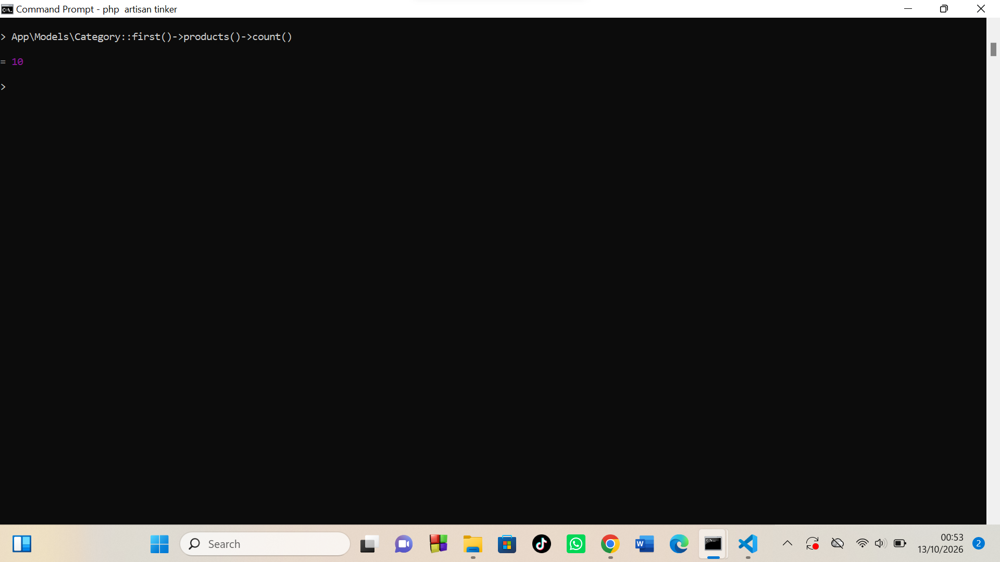
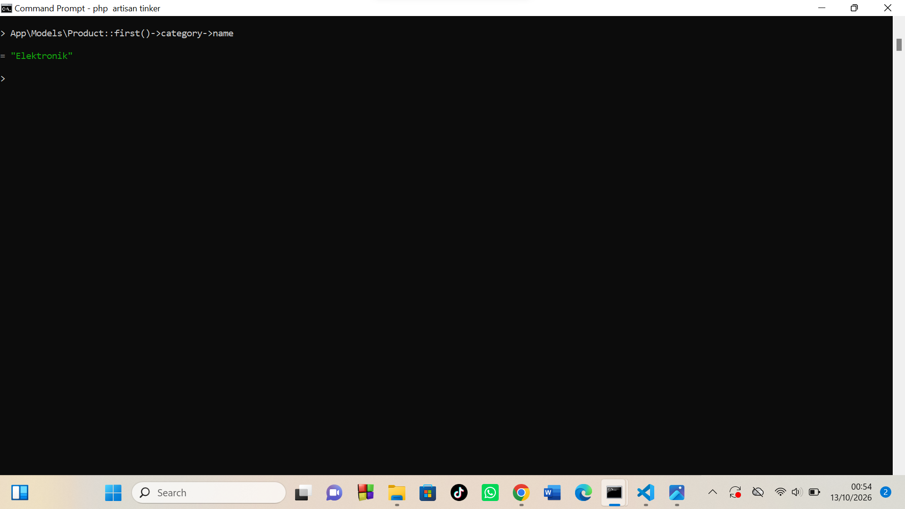
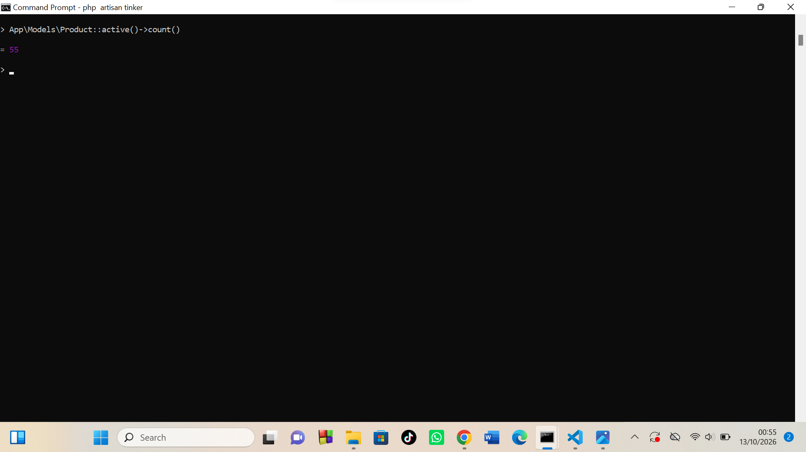
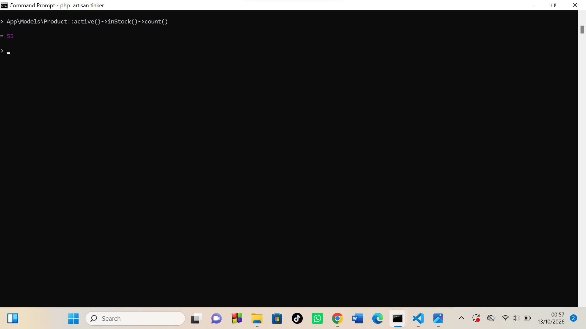
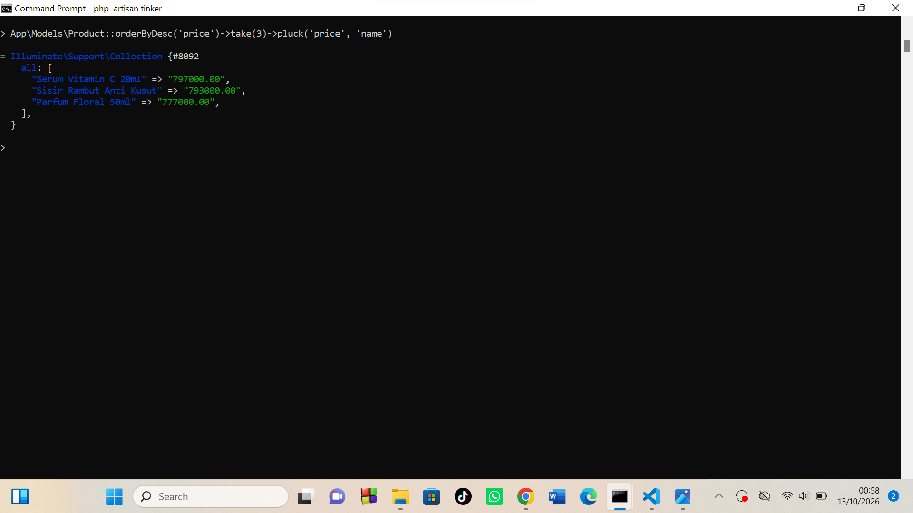

## Bukti Tes Role

### Editor
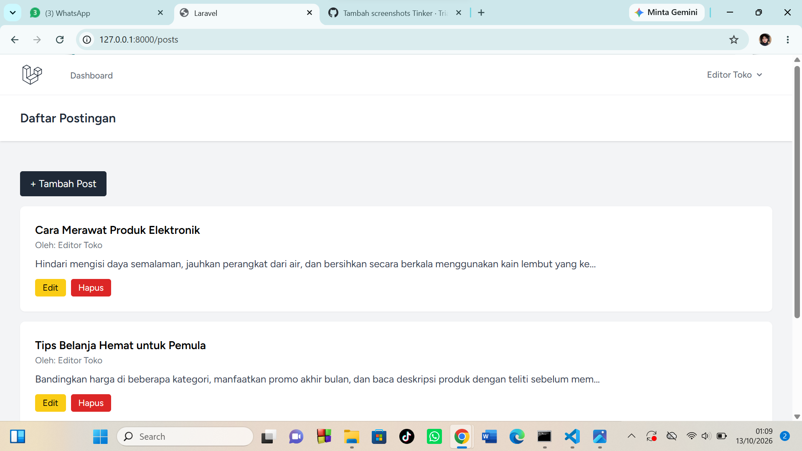
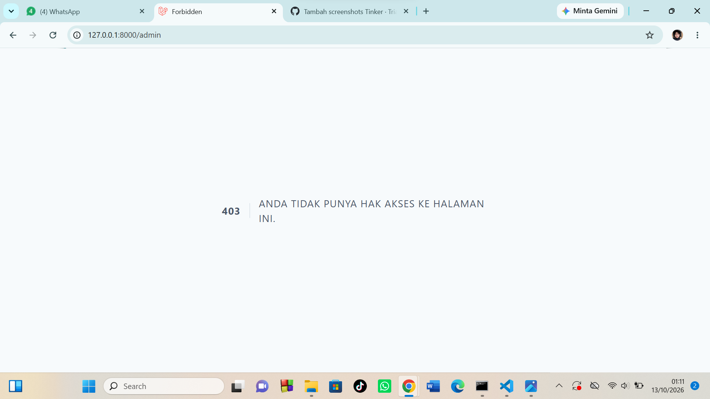
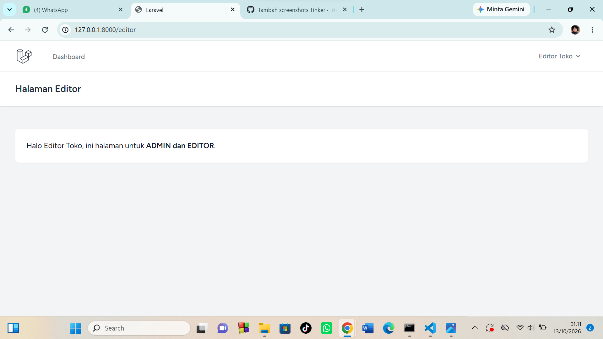

### User
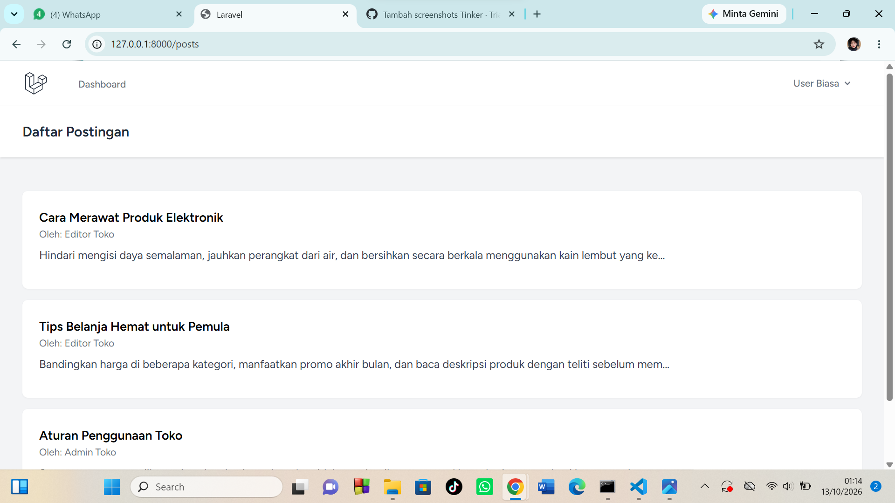
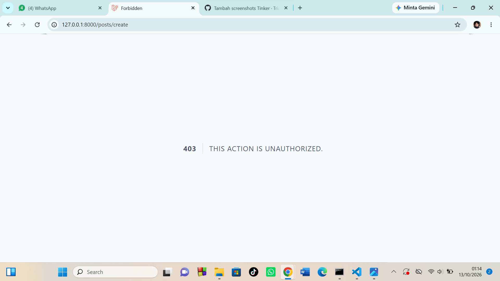


### Admin


### Tes Incognito 2 Role
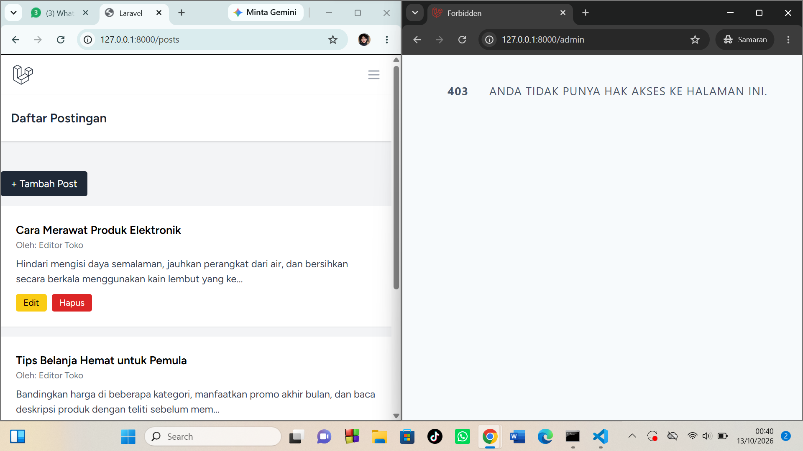